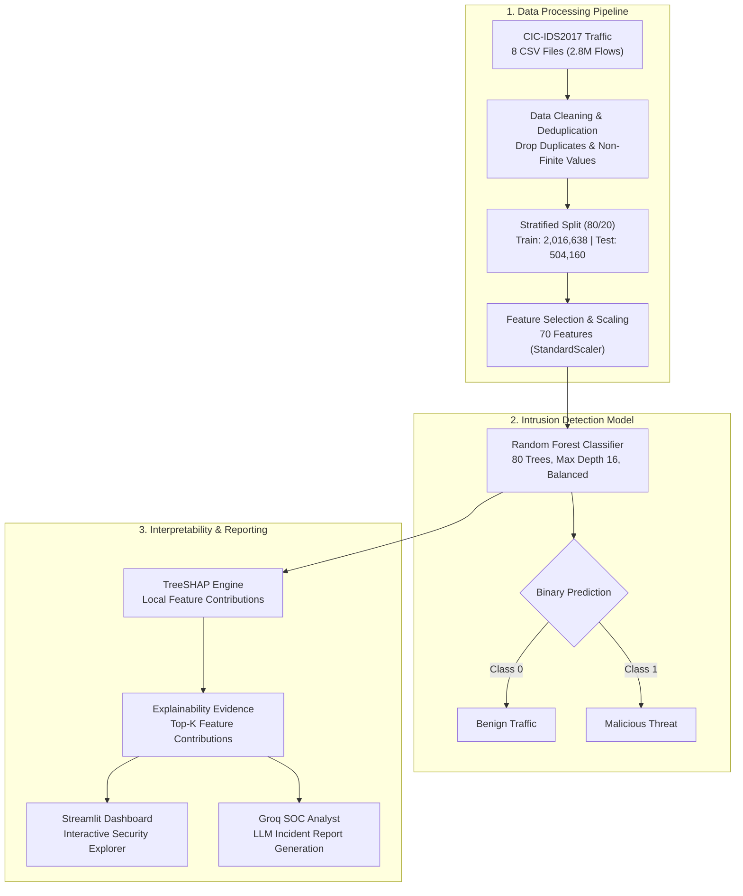

# AI-NIDS: Explainable AI Network Intrusion Detection System

An explainable machine learning system for detecting malicious network traffic, understanding model predictions, and generating AI-assisted security analysis reports.

AI-NIDS combines **Random Forest classification**, **SHAP explainability**, **Groq-powered SOC analysis**, and an interactive **Streamlit dashboard**.

The project uses the CIC-IDS2017 dataset and focuses on making intrusion detection results easier to interpret, rather than presenting predictions as confirmed security incidents.

## Key Features

- **Network intrusion detection:** Classifies network flows as benign or malicious using an optimized Random Forest model.
- **Explainable predictions:** Uses SHAP to extract influential flow features for local interpretability.
- **AI-assisted SOC reports:** Generates structured security analysis using Groq based on model predictions and SHAP evidence.
- **Interactive dashboard:** Streamlit interface for exploratory flow triage, feature waterfalls, and confidence scoring.
- **Automated testing:** 11 comprehensive automated tests covering model artifacts, predictions, SHAP, API fallbacks, and day-isolation invariants.
- **Graceful degradation:** Local SHAP explanations and triage remain fully operational when Groq API keys are absent or unavailable.

## System Architecture

The AI-NIDS architecture combines high-throughput data processing, tree-based machine learning, local model interpretability, and LLM-assisted incident analysis:



## Dataset & Preprocessing

The system is evaluated on **CIC-IDS2017**, an established benchmark dataset covering realistic background traffic and simulated cyberattacks captured over five consecutive business days.

### Binary Classification Formulation

While CIC-IDS2017 includes multiple attack categories (DoS, Web Attacks, Brute Force, Infiltration, Port Scanning, DDoS, and Botnets), this baseline implements binary intrusion detection:
- **`0` — BENIGN:** Normal background network activity.
- **`1` — MALICIOUS:** Network flows generated during simulated attack scenarios.

### Preprocessing & Data Cleaning

Data preparation follows a strict leakage-free workflow:

1. **Ingestion & Schema Validation:** 8 raw CSV files (2,830,743 flows) are loaded in chunks with stripped headers and schema verification.
2. **Internal Deduplication:** Duplicate flows within the dataset are identified and removed (308,381 duplicate records dropped).
3. **Numerical Cleaning:** Infinite values (`+inf`, `-inf`) and non-numeric entries are coerced and discarded (1,564 non-finite rows dropped).
4. **Stratified Split:** An 80/20 train/test split preserves class distributions without cross-split mixing.
5. **Feature Filtering:** Zero-variance features are identified exclusively on the training split (8 constant columns removed).
6. **Feature Normalization:** `StandardScaler` is fitted strictly on training data and applied across both splits.

### Preprocessing Summary

| Pipeline Stage | Flow Count | Notes & Impact |
| :--- | :---: | :--- |
| **Raw Ingestion** | 2,830,743 | 8 original CSV files from CIC-IDS2017 |
| **Duplicates Removed** | -308,381 | Exact within-dataset duplicate records purged |
| **Invalid Records Dropped** | -1,564 | Rows containing `NaN`, `+inf`, or `-inf` |
| **Clean Dataset** | **2,520,798** | Cleaned, finite feature vectors |
| **Training Partition (80%)** | 2,016,638 | Used exclusively for feature selection, scaling, and training |
| **Testing Partition (20%)** | 504,160 | Held-out stratified random test set |
| **Retained Features** | **70** | 8 constant features dropped based strictly on train data |

## Machine Learning Model

The baseline classifier is a **Random Forest** built with `scikit-learn`, selected for its strong tabular data performance, resistance to overfitting, and native compatibility with TreeSHAP.

### Model Configuration

| Hyperparameter | Setting | Design Rationale |
| :--- | :---: | :--- |
| **Algorithm** | Random Forest | Ensemble of decorrelated decision trees |
| **Estimators (`n_estimators`)** | 80 | Balances predictive accuracy with low-latency inference |
| **Max Depth (`max_depth`)** | 16 | Restricts tree complexity to prevent overfitting |
| **Min Samples Leaf (`min_samples_leaf`)** | 2 | Smooths probability estimates in terminal nodes |
| **Class Weighting (`class_weight`)** | `'balanced'` | Compensates for natural benign/malicious class imbalance |
| **Feature Fraction (`max_features`)** | `'sqrt'` | $\approx \sqrt{70} \approx 8$ features considered per split |
| **Random State (`random_state`)** | 42 | Ensures deterministic reproducibility |

### In-Distribution Baseline Performance

Evaluated on the 504,160 flows in the stratified random test split:

| Evaluation Metric | Score | Verified Counts |
| :--- | :---: | :--- |
| **Overall Accuracy** | **99.88%** | 503,533 / 504,160 flows correctly classified |
| **Malicious Precision** | **99.37%** | 85,058 true malicious alerts vs. 537 false alarms |
| **Malicious Recall** | **99.89%** | 85,058 detected out of 85,148 malicious flows |
| **Malicious F1-Score** | **99.63%** | Harmonic mean of precision and recall |
| **Benign Specificity** | **99.87%** | 418,475 detected out of 419,012 benign flows |

#### Confusion Matrix `[[TN, FP], [FN, TP]]`

| Ground Truth \ Prediction | Predicted Benign (`0`) | Predicted Malicious (`1`) | Total Actual | Performance |
| :--- | :---: | :---: | :---: | :---: |
| **Actual Benign (`0`)** | **418,475** (TN) | **537** (FP) | 419,012 | **99.87%** Specificity |
| **Actual Malicious (`1`)** | **90** (FN) | **85,058** (TP) | 85,148 | **99.89%** Recall |
| **Total Predicted** | 418,565 | 85,595 | **504,160** | **99.37%** Precision |

> **Contextual Note:** These high metrics reflect standard in-distribution testing where test flows share attack sessions with the training set. For performance on unfamiliar, zero-day attack categories, see the [Generalization Evaluation](#generalization-evaluation-held-out-friday-experiment) below.

## Generalization Evaluation: Held-Out Friday Experiment

To evaluate how well the Random Forest model generalizes to unseen attack categories and temporal distribution shifts, we performed a separate **held-out-day generalization experiment**.

The model was trained strictly on traffic from **Monday through Thursday** (1,924,938 flows) and evaluated exclusively on traffic from **Friday** (592,328 flows). All Friday attack types (**DDoS**, **PortScan**, and **Bot**) were completely absent from the Monday–Thursday training data.

### Baseline vs. Held-Out Day Comparison

| Metric | Random Split (Baseline) | Held-Out Friday (Generalization) |
|---|---:|---:|
| **Accuracy** | 99.88% | 76.42% |
| **Malicious Precision** | 99.37% | 99.42% |
| **Malicious Recall** | 99.89% | 36.77% |
| **Malicious F1-Score** | 99.63% | 53.68% |
| **Benign Specificity** | 99.87% | 99.87% |
| **DDoS Recall** | *(in split)* | 62.91% |
| **PortScan Recall** | *(in split)* | 0.43% |
| **Bot Recall** | *(in split)* | 0.00% |

**Key Finding:** While benign traffic remained highly stationary (99.87% specificity with only 470 false alarms out of 372,238 flows), malicious recall dropped significantly on unfamiliar attacks. The model partially detected unseen DDoS attacks (62.91%) due to structural similarities with training DoS floods, but missed virtually all unseen PortScan (0.43%) and Botnet (0.00%) traffic. This demonstrates that standard random-split benchmarks can significantly overestimate an intrusion detection system's readiness for zero-day threats.

For the complete methodology, cross-split duplicate removal, confusion matrices, and feature importances, see the full research report:  
👉 [**AI-NIDS: Evaluating Generalization to Unseen Network Attacks**](docs/held_out_day_evaluation.md)

## Explainable AI with SHAP

AI-NIDS uses **SHAP (SHapley Additive exPlanations)** to explain individual model predictions.

For a selected network flow, the system identifies influential features and displays:
- **Feature name:** The measured flow metric (e.g., `Bwd Packet Length Std`, `Average Packet Size`).
- **Original feature value:** Unscaled physical measurement for domain interpretation.
- **SHAP contribution:** Exact positive or negative impact on the decision log-odds.
- **Directional indicator:** Whether the feature supports or opposes the predicted class.

> **Interpretation Note:** SHAP explains the internal reasoning of the decision trees. Feature influence does not establish physical attack causality.

## Groq-Powered SOC Reports

The system integrates Groq to produce AI-assisted security analysis using the model prediction, predicted-class probability, and selected SHAP feature evidence.

Reports are structured around four core sections:
1. **Executive Assessment:** High-level summary of the alert confidence.
2. **Technical Evidence:** Synthesis of influential flow features.
3. **Caveats & Limitations:** Transparent acknowledgment of model uncertainty.
4. **Defensive Next Steps:** Practical triage recommendations for SOC tier-1 analysts.

**Security Notice:** A machine learning prediction is an investigative signal, not a confirmed security breach. Groq-generated reports must be reviewed by a qualified security analyst.

**Resilience:** The application features graceful degradation. If the Groq API key is missing or the external service fails, local SHAP explanations and Streamlit visualizations remain fully operational.

## Streamlit Dashboard

The interactive dashboard allows security teams to explore network intrusion predictions and their explanations:
- **Batch Evaluation:** Interactive preview of test traffic samples.
- **Single-Flow Triage:** In-depth probability breakdown and confidence gauge.
- **Local SHAP Waterfall:** Visual attribution of top features influencing the alert.
- **SOC Analyst Assistant:** On-demand generation of structured LLM incident summaries.

Run the dashboard locally:
```bash
streamlit run app.py
```
The application opens at: `http://localhost:8501`

## Installation

### 1. Clone the Repository
```bash
git clone https://github.com/SMHC-hub/AI-NIDS.git
cd AI-NIDS
```

### 2. Create a Virtual Environment
Python 3.11 is recommended.

On Windows PowerShell:
```powershell
py -3.11 -m venv .venv
.\.venv\Scripts\Activate.ps1
```

### 3. Install Dependencies
```bash
python -m pip install -r requirements.txt
```

### 4. Prepare the Dataset
Obtain the CIC-IDS2017 MachineLearningCVE CSV files from an authorized dataset source. Place the eight CSV files inside:
```text
data/raw/CIC-IDS-2017/CSVs/MachineLearningCSV/MachineLearningCVE/
```

### 5. Run Preprocessing
```bash
python preprocess.py
```
This generates processed training and testing datasets, the feature list, and the fitted scaler.

### 6. Train the Model
```bash
python safe_train.py
```
The training script produces the baseline Random Forest model and evaluation artifacts under an 11.0 GiB RAM guardrail.

### 7. Configure Groq (Optional)
Create a local `.env` file using `.env.example` as a reference:
```env
GROQ_API_KEY=your_actual_groq_api_key_here
GROQ_MODEL=openai/gpt-oss-120b
```
Never commit real API keys or `.env` files to GitHub.

### 8. Start the Dashboard
```bash
streamlit run app.py
```

## Automated Tests

Run the automated test suite across baseline and generalization components:
```bash
python -m pytest tests/ -v
```

The test suite covers 11 automated test cases:
- Model artifact availability and schema integrity
- Feature compatibility across scalers and classifiers
- Binary prediction and probability calibration bounds
- Local SHAP waterfall explanation correctness
- Graceful Groq API missing key and network failure handling
- Strict day-partition file isolation (zero Monday–Thursday and Friday overlap)
- Cross-split duplicate flow purging to prevent leakage
- Train-only feature selection and StandardScaler fitting invariants

Latest verified result: **11 passed, 0 failed**.

## Project Structure

```text
AI-NIDS/
├── app.py
├── preprocess.py
├── train_model.py
├── safe_train.py
├── xai_engine.py
├── requirements.txt
├── Dockerfile
├── .dockerignore
├── .env.example
├── .gitignore
├── README.md
├── data/
│   ├── raw/
│   └── processed/
├── models/
├── experiments/
│   ├── held_out_day.py
│   ├── safe_run_held_out_day.py
│   └── results/held_out_day/
├── tests/
│   ├── test_ai_nids.py
│   └── test_held_out_day.py
└── docs/
    └── held_out_day_evaluation.md
```

## Limitations

This project is a research and portfolio prototype, not a production-ready intrusion detection system.
- **Random flow splitting:** Standard random test splits share sessions with training data, inflating evaluation scores.
- **Unseen attack blindspots:** Supervised models struggle with novel attack families (e.g., 0.43% PortScan and 0.00% Botnet recall on Friday).
- **Binary classification:** The model flags benign vs. malicious traffic but does not identify specific attack categories.
- **False positives & negatives:** Predictions are probabilistic signals and can incorrectly flag benign activity or miss subtle threats.
- **Explainability limits:** SHAP identifies influential model features, not physical network causality.
- **AI-generated text:** Groq LLM reports may hallucinate and must be validated by human security personnel.
- **Deployment context:** Evaluated offline on simulated data; not validated for real-time in-line packet filtering.

## Future Improvements

- Multiclass attack classification with uncertainty estimation
- Semi-supervised and anomaly detection models (Isolation Forests, Autoencoders) for zero-day discovery
- Decision threshold calibration for optimizing reconnaissance detection
- Cross-dataset evaluation on modern benchmarks (CSE-CIC-IDS2018, UNSW-NB15)
- Automated CI/CD testing and container security hardening

## Technology Stack

- **Language:** Python 3.11
- **Machine Learning:** scikit-learn, pandas, NumPy
- **Explainability:** SHAP
- **Generative AI:** Groq API
- **Dashboard:** Streamlit
- **Testing:** pytest
- **Containerization:** Docker

## Docker Deployment

AI-NIDS supports containerized deployment using Docker:

### Build the Image
```powershell
docker build -t ai-nids:1.0 .
```

### Run the Container
```powershell
docker run -d `
  --name ai-nids-app `
  -p 8502:8501 `
  --env-file .env `
  --mount "type=bind,source=${PWD}\models,target=/app/models,readonly" `
  --mount "type=bind,source=${PWD}\data\processed,target=/app/data/processed,readonly" `
  ai-nids:1.0
```
Open the dashboard at: `http://localhost:8502`

### Container Management
```powershell
# Verify container status
docker ps -a --filter "name=ai-nids-app"

# Stop and remove container
docker rm -f ai-nids-app
```

## Project Purpose

AI-NIDS was developed to explore how machine learning, explainable AI, and large language models can work together in cybersecurity. The goal is not only to classify network traffic but also to make predictions understandable and provide actionable evidence for security investigation.

## Project Credits

- **Project:** AI-NIDS — Explainable AI Network Intrusion Detection System
- **Developed by:** Syed Muhammad Huzaifa Chishty
- **Role:** Founder & AI Engineer
- **Organization:** SASH Innoventures

AI-NIDS is an applied AI and cybersecurity project developed as part of the founder's technical portfolio at SASH Innoventures. The project combines machine learning, explainable AI (SHAP), and LLM-assisted security analysis to demonstrate an interpretable approach to network intrusion detection.
